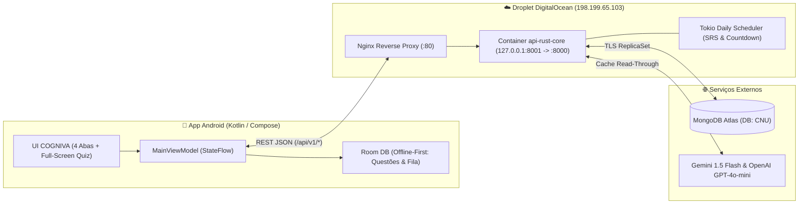

# 🧠 COGNIVA

**CONHECIMENTO EM EVOLUÇÃO.**  
`LEARN · PRACTICE · EVOLVE`

Uma plataforma inteligente de aprendizagem, preparação de alto desempenho para concursos públicos e desenvolvimento de competências.

---

## 1. Identidade & Ecossistema COGNIVA

* **Nome:** COGNIVA
* **Categoria:** EdTech / Learning & Assessment Platform
* **Personalidade:** Inteligente, sofisticada, confiável e tecnológica
* **Público:** Candidatos a concursos públicos de alto nível (CPNU/AFT, Receita Federal, BNDES, etc.), estudantes e profissionais
* **Slogan Principal:** *Conhecimento em evolução.*
* **Identidade Visual:** Azul-Marinho Profundo (`#071120` / `#0E1D34`), Azul Elétrico (`#0066FF` / `#38BDF8`) e Branco Puro (`#FFFFFF`), acompanhados de símbolo geométrico neural que combina cérebro, conexões sinápticas e evolução ascendente.

### Módulos do Ecossistema

| Produto | Finalidade | Implementação na Plataforma |
| :--- | :--- | :--- |
| **Cogniva Learn** | Aprendizagem | Revisão Espaçada (SRS adaptativo 3–90 dias com decaimento diário de 1%) e estudo ativo por tópicos |
| **Cogniva Questions** | Banco de questões | Múltipla Escolha e Certo/Errado (Cebraspe), Desafio Adaptativo (*The Most Badass*), *Tronco Comum* e *Caderno de Erros* |
| **Cogniva Exams** | Simulados | Simulados oficiais ponderados em tela cheia com cronômetro regressivo, cálculo de Nota Líquida e comparação com nota de corte histórica |
| **Cogniva Insights** | Analytics e desempenho | Índice de Prontidão vs. Corte Histórico, Matriz 2×2 Confiança × Acerto (com detecção de *Ponto Cego*) e Heatmap diário |
| **Cogniva AI** | Assistente inteligente | 8 Tutores Pedagógicos sob demanda (*Dr. Sincero, Dica Progressiva, Mnemônico, Plausibilidade de Distratores, Conceitos-Chave, ELI10*) com cache persistente no banco |
| **Cogniva Planner** | Planejamento de estudos | Painel diário *Hoje*, Edital Verticalizado (Oficial e Estimado com selos de transparência) e *Tela de Diff* (Previsto ➔ Edital Publicado) |

---

## 2. Arquitetura Técnica Unificada

O projeto sucedeu o antigo bot de Telegram (`AFTBot.py`), preservando **100% do histórico de questões e interações** no MongoDB Atlas (`database: CNU`) e migrando para uma stack moderna de altíssima eficiência:

* **Frontend Mobile (`android-app/`):** **Kotlin + Jetpack Compose (Material 3)** + Arquitetura **Offline-First (Room + WorkManager + Retrofit)**. Zero JVM no servidor.
* **Backend Core (`backend-rust/`):** **Rust (`Axum` + `Tokio` + `mongodb`)** compilado em binário nativo estático dentro de container Debian Bookworm Slim (`< 40 MB`), consumindo ~15 MB de RAM em repouso.
* **Persistência (`MongoDB Atlas`):** Cluster M0 Sandbox mantendo compatibilidade total com as coleções legadas (`todasQuestoes`, `userActivityLog`, `usuarios`, `reportedQuestoes`, `utils`) e adicionando `concursos` e `editais_topicos`.
* **Infraestrutura & CI/CD (`DigitalOcean + GitHub Actions + GHCR`):** Pipeline **Zero Build na VPS** — toda compilação ocorre no GitHub Actions com cache de camadas (`type=gha`), publicando a imagem pronta no GitHub Container Registry (`ghcr.io/danielcdes-create/api-rust-core:latest`) e atualizando o Droplet via SSH.



---

## 3. Estrutura do Repositório

```text
├── .github/workflows/
│   └── deploy.yml                  # Pipeline CI/CD (Build Multi-Stage no GHA -> GHCR -> Deploy SSH no Droplet)
├── backend-rust/                   # Microsserviço api-rust-core (Axum + Tokio + MongoDB)
│   ├── Dockerfile                  # Build Multi-Stage (< 40 MB final, usuário não-root appuser)
│   ├── Cargo.toml                  # Dependências e otimizações de release (lto = true, strip = true)
│   └── src/
│       ├── main.rs                 # Roteador Axum e bootstrap do agendador diário
│       ├── config.rs & error.rs    # Configuração via ENV e tratamento centralizado de erros HTTP
│       ├── models/                 # Structs BSON/JSON retrocompatíveis (question, contest, activity, user)
│       ├── services/               # Motores: srs_engine, difficulty, quiz_selector, ai_tutor, seed, scheduler
│       └── routes/                 # Handlers REST: auth, home, contests, quiz, ai_help, analytics
├── android-app/                    # Aplicativo Android Nativo COGNIVA (Kotlin + Jetpack Compose)
│   ├── app/src/main/java/br/com/concursoprep/app/
│   │   ├── ConcursoApp.kt          # Inicialização Room + OkHttp + Retrofit + WorkManager
│   │   ├── MainActivity.kt         # Host de navegação (Onboarding, 4 Abas e Sessão Full-Screen)
│   │   ├── data/                   # Room DAO/Entities, Retrofit Service, Repository e OfflineSyncWorker
│   │   ├── domain/model/Models.kt  # DTOs serializáveis e as 20 categorias de reporte (VALID_PROBLEM_CATEGORIES)
│   │   └── ui/                     # MainViewModel, Theme COGNIVA e Telas (Today, Contests, Practice, Progress, Onboarding)
├── deploy/
│   └── nginx-concursoprep.conf     # Configuração do Proxy Reverso Nginx (/api/v1/ -> 127.0.0.1:8001)
├── Notas Conversao Kotlin_Rust/    # Especificações de produto, UX e diretrizes arquiteturais de CI/CD
├── docker-compose.yml              # Orquestração em produção (/opt/apps/docker-compose.yml no Droplet)
├── .env.rust.example               # Modelo de variáveis de ambiente para o container Rust
└── Cogniva-v1.0.0.apk              # Instalador Android compilado e conectado à produção
```

---

## 4. Catálogo de Endpoints da API (`api-rust-core`)

Base URL em Produção: `http://198.199.65.103/api/v1`

| Método | Rota | Módulo COGNIVA | Descrição |
| :--- | :--- | :--- | :--- |
| `GET` | `/api/v1/health` | Core | Healthcheck instantâneo do container Rust |
| `POST` | `/api/v1/auth/telegram-link` | Core / Auth | Vincula conta legada do Bot Telegram (`user_id` ou `@username`) importando histórico do banco `CNU` |
| `PUT` | `/api/v1/auth/onboarding` | Cogniva Planner | Salva concursos-alvo em escada e metas diárias de estudo |
| `GET` | `/api/v1/home/today?user_id={id}` | Cogniva Planner | Retorna pulso do dia, revisões SRS vencidas, Caderno de Erros, contagens regressivas e sugestão de *Tronco Comum* |
| `GET` | `/api/v1/contests` | Cogniva Planner | Lista concursos disponíveis (CPNU, RFB, BNDES) e status (`EDITAL_PUBLICADO`, `SOLICITADO_AUTORIZADO`, `PREVISTO`) |
| `GET` | `/api/v1/contests/:id/syllabus?user_id={id}` | Cogniva Planner | Retorna árvore do Edital Verticalizado com percentual de domínio por disciplina e selos de transparência (`HIGH`, `MEDIUM`, `LOW`) |
| `GET` | `/api/v1/contests/:id/diff` | Cogniva Planner | Retorna a *Tela de Diff* (tópicos confirmados, novos no edital e removidos/arquivados) |
| `POST` | `/api/v1/quiz/generate` | Cogniva Questions / Exams | Gera baterias nos modos `STANDARD`, `SHUFFLE`, `SIMULADO`, `MOST_BADASS`, `SRS_REVIEW`, `ERROR_NOTEBOOK`, `COMMON_TRUNK` e `SINGLE` |
| `POST` | `/api/v1/quiz/submit-batch` | Cogniva Learn / SRS | Recebe lote de respostas (online ou sincronizadas do Room offline), calcula SRS, decaimento e Matriz de Confiança |
| `POST` | `/api/v1/questions/:id/ai/:kind` | Cogniva AI | Aciona ou lê do cache em `todasQuestoes` os 8 assistentes de IA (`explanation`, `dr-sincero`, `contextual-hint`, `mnemonic`, `plausibility`, `extra-concepts`, `child-friendly-pre`, `child-friendly-post`) |
| `POST` | `/api/v1/questions/:id/report` | Cogniva Questions | Registra inconsistência na coleção `reportedQuestoes` e incrementa `reports` na questão |
| `GET` | `/api/v1/analytics/progress?user_id={id}` | Cogniva Insights | Retorna Índice de Prontidão vs. Nota de Corte, Matriz 2×2 Confiança × Acerto, barras por disciplina e Heatmap |

---

## 5. Operação & Deploy Contínuo (CI/CD Custo Zero)

### Regras Inegociáveis da VPS
1. **Proibido compilar no Droplet:** Nunca execute `cargo build` ou `docker build` dentro do Droplet DigitalOcean.
2. **Gatilhos de Deploy:**
   * **Manual:** Aba **Actions** no GitHub ➔ *CI/CD - Build & Deploy to DigitalOcean* ➔ **Run workflow**.
   * **Por Tag de Versão:**
     ```bash
     git tag v1.0.1
     git push origin v1.0.1
     ```
   * **Commits apenas de documentação ou Android sem acionar CI:** Inclua `[skip ci]` na mensagem de commit.

### Comandos Úteis no Droplet (`198.199.65.103`)
```bash
# Verificar status do container Rust e demais serviços
docker ps

# Acompanhar logs em tempo real do api-rust-core
docker logs -f --tail 50 api-rust-core

# Testar saúde da API localmente no servidor
curl http://127.0.0.1:8001/api/v1/health
```

---

## 6. Compilação do App Android (`android-app/`)

Para gerar um novo APK pela linha de comando no Windows:

```powershell
$env:JAVA_HOME = "C:\Program Files\Android\Android Studio\jbr"
cd C:\Users\danie\Telebot\android-app
.\gradlew.bat assembleDebug
```

O APK compilado estará disponível em:
`android-app/app/build/outputs/apk/debug/app-debug.apk` (e copiado na raiz como `Cogniva-v1.0.0.apk`).
