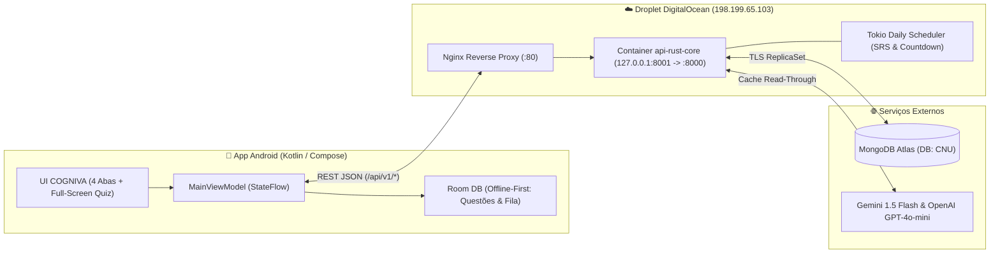
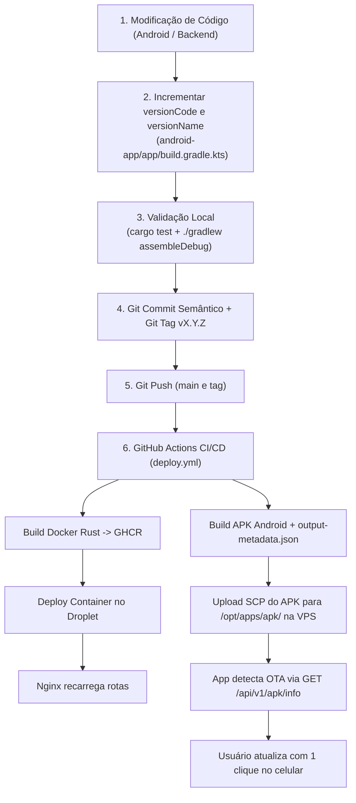

# 🧠 COGNIVA

**CONHECIMENTO EM EVOLUÇÃO.**  
`LEARN · PRACTICE · EVOLVE`

Uma plataforma inteligente de aprendizagem, preparação de alto desempenho para concursos públicos e desenvolvimento de competências.

---

## 1. Identidade & Ecossistema COGNIVA

* **Nome:** COGNIVA
* **Categoria:** EdTech / Learning & Assessment Platform
* **Personalidade:** Inteligente, sofisticada, confiável e tecnológica
* **Público:** Candidatos a concursos públicos de alto nível (CPNU/AFT, Receita Federal, BNDES, etc.), estudantes e profissionais
* **Slogan Principal:** *Conhecimento em evolução.*
* **Identidade Visual:** Azul-Marinho Profundo (`#071120` / `#0E1D34`), Azul Elétrico (`#0066FF` / `#38BDF8`) e Branco Puro (`#FFFFFF`), acompanhados de símbolo geométrico neural que combina cérebro, conexões sinápticas e evolução ascendente.

### Módulos do Ecossistema

| Produto | Finalidade | Implementação na Plataforma |
| :--- | :--- | :--- |
| **Cogniva Learn** | Aprendizagem | Revisão Espaçada (SRS adaptativo 3–90 dias com decaimento diário de 1%) e estudo ativo por tópicos |
| **Cogniva Questions** | Banco de questões | Múltipla Escolha e Certo/Errado (Cebraspe), Desafio Adaptativo (*The Most Badass*), *Tronco Comum* e *Caderno de Erros* |
| **Cogniva Exams** | Simulados | Simulados oficiais ponderados em tela cheia com cronômetro regressivo, cálculo de Nota Líquida e comparação com nota de corte histórica |
| **Cogniva Insights** | Analytics e desempenho | Índice de Prontidão vs. Corte Histórico, Matriz 2×2 Confiança × Acerto (com detecção de *Ponto Cego*) e Heatmap diário |
| **Cogniva AI** | Assistente inteligente | 8 Tutores Pedagógicos sob demanda (*Dr. Sincero, Dica Progressiva, Mnemônico, Plausibilidade de Distratores, Conceitos-Chave, ELI10*) com cache persistente no banco |
| **Cogniva Planner** | Planejamento de estudos | Painel diário *Hoje*, Edital Verticalizado (Oficial e Estimado com selos de transparência) e *Tela de Diff* (Previsto ➔ Edital Publicado) |

---

## 2. Arquitetura Técnica Unificada

O projeto sucedeu o antigo bot de Telegram (`AFTBot.py`), preservando **100% do histórico de questões e interações** no MongoDB Atlas (`database: CNU`) e migrando para uma stack moderna de altíssima eficiência:

* **Frontend Mobile (`android-app/`):** **Kotlin + Jetpack Compose (Material 3)** + Arquitetura **Offline-First (Room + WorkManager + Retrofit)**. Zero JVM no servidor.
* **Backend Core (`backend-rust/`):** **Rust (`Axum` + `Tokio` + `mongodb`)** compilado em binário nativo estático dentro de container Debian Bookworm Slim (`< 40 MB`), consumindo ~15 MB de RAM em repouso.
* **Persistência (`MongoDB Atlas`):** Cluster M0 Sandbox mantendo compatibilidade total com as coleções legadas (`todasQuestoes`, `userActivityLog`, `usuarios`, `reportedQuestoes`, `utils`) e adicionando `concursos` e `editais_topicos`.
* **Infraestrutura & CI/CD (`DigitalOcean + GitHub Actions + GHCR`):** Pipeline **Zero Build na VPS** — toda compilação ocorre no GitHub Actions com cache de camadas (`type=gha`), publicando a imagem pronta no GitHub Container Registry (`ghcr.io/danielcdes-create/api-rust-core:latest`) e atualizando o Droplet via SSH.



---

## 3. Estrutura do Repositório

```text
├── .github/workflows/
│   └── deploy.yml                  # Pipeline CI/CD (Build Multi-Stage no GHA -> GHCR -> Deploy SSH no Droplet)
├── backend-rust/                   # Microsserviço api-rust-core (Axum + Tokio + MongoDB)
│   ├── Dockerfile                  # Build Multi-Stage (< 40 MB final, usuário não-root appuser)
│   ├── Cargo.toml                  # Dependências e otimizações de release (lto = true, strip = true)
│   └── src/
│       ├── main.rs                 # Roteador Axum e bootstrap do agendador diário
│       ├── config.rs & error.rs    # Configuração via ENV e tratamento centralizado de erros HTTP
│       ├── models/                 # Structs BSON/JSON retrocompatíveis (question, contest, activity, user)
│       ├── services/               # Motores: srs_engine, difficulty, quiz_selector, ai_tutor, seed, scheduler
│       └── routes/                 # Handlers REST: auth, home, contests, quiz, ai_help, analytics
├── android-app/                    # Aplicativo Android Nativo COGNIVA (Kotlin + Jetpack Compose)
│   ├── app/src/main/java/br/com/concursoprep/app/
│   │   ├── ConcursoApp.kt          # Inicialização Room + OkHttp + Retrofit + WorkManager
│   │   ├── MainActivity.kt         # Host de navegação Edge-to-Edge (Onboarding, 5 Abas e Sessão Imersiva)
│   │   ├── data/                   # Room DAO/Entities, Retrofit Service, Repository e OfflineSyncWorker
│   │   ├── domain/model/Models.kt  # DTOs serializáveis e categorias de reporte (VALID_PROBLEM_CATEGORIES)
│   │   └── ui/
│   │       ├── MainViewModel.kt    # StateFlow desacoplado, offline sync e OTA manager
│   │       ├── components/         # LetterBadge (36dp fixo), OptionCard, ActionChips, ConfidenceGrid, MarkdownParser
│   │       ├── theme/              # Theme.kt (Tokens WCAG AA), Type.kt (Métricas sp), PreviewMatrix.kt
│   │       └── screens/            # TodayScreen, ContestsScreen, PracticeAndQuestionScreen, ProgressScreen, SettingsScreen, OnboardingScreen
├── deploy/
│   └── nginx-concursoprep.conf     # Configuração do Proxy Reverso Nginx (/api/v1/ -> 127.0.0.1:8001)
├── Notas Conversao Kotlin_Rust/    # Especificações de produto, UX e diretrizes arquiteturais de CI/CD
├── docker-compose.yml              # Orquestração em produção (/opt/apps/docker-compose.yml no Droplet)
├── .env.rust.example               # Modelo de variáveis de ambiente para o container Rust
└── Cogniva-v1.0.0.apk              # Instalador Android compilado e conectado à produção
```

---

## 4. Catálogo de Endpoints da API (`api-rust-core`)

Base URL em Produção: `http://198.199.65.103/api/v1`

| Método | Rota | Módulo COGNIVA | Descrição |
| :--- | :--- | :--- | :--- |
| `GET` | `/api/v1/health` | Core | Healthcheck instantâneo do container Rust |
| `POST` | `/api/v1/auth/telegram-link` | Core / Auth | Vincula conta legada do Bot Telegram (`user_id` ou `@username`) importando histórico do banco `CNU` |
| `PUT` | `/api/v1/auth/onboarding` | Cogniva Planner | Salva concursos-alvo em escada e metas diárias de estudo |
| `GET` | `/api/v1/home/today?user_id={id}` | Cogniva Planner | Retorna pulso do dia, revisões SRS vencidas, Caderno de Erros, contagens regressivas e sugestão de *Tronco Comum* |
| `GET` | `/api/v1/contests` | Cogniva Planner | Lista concursos disponíveis (CPNU, RFB, BNDES) e status (`EDITAL_PUBLICADO`, `SOLICITADO_AUTORIZADO`, `PREVISTO`) |
| `GET` | `/api/v1/contests/:id/syllabus?user_id={id}` | Cogniva Planner | Retorna árvore do Edital Verticalizado com percentual de domínio por disciplina e selos de transparência (`HIGH`, `MEDIUM`, `LOW`) |
| `GET` | `/api/v1/contests/:id/diff` | Cogniva Planner | Retorna a *Tela de Diff* (tópicos confirmados, novos no edital e removidos/arquivados) |
| `POST` | `/api/v1/quiz/generate` | Cogniva Questions / Exams | Gera baterias nos modos `STANDARD`, `SHUFFLE`, `SIMULADO`, `MOST_BADASS`, `SRS_REVIEW`, `ERROR_NOTEBOOK`, `COMMON_TRUNK` e `SINGLE` |
| `POST` | `/api/v1/quiz/submit-batch` | Cogniva Learn / SRS | Recebe lote de respostas (online ou sincronizadas do Room offline), calcula SRS, decaimento e Matriz de Confiança |
| `POST` | `/api/v1/questions/:id/ai/:kind` | Cogniva AI | Aciona ou lê do cache em `todasQuestoes` os 8 assistentes de IA (`explanation`, `dr-sincero`, `contextual-hint`, `mnemonic`, `plausibility`, `extra-concepts`, `child-friendly-pre`, `child-friendly-post`) |
| `POST` | `/api/v1/questions/:id/report` | Cogniva Questions | Registra inconsistência na coleção `reportedQuestoes` e incrementa `reports` na questão |
| `GET` | `/api/v1/analytics/progress?user_id={id}` | Cogniva Insights | Retorna Índice de Prontidão vs. Nota de Corte, Matriz 2×2 Confiança × Acerto, barras por disciplina e Heatmap |
| `GET` | `/api/v1/apk/info` | Core / OTA Update | Retorna metadados da versão do APK publicada no servidor (`version_code`, `version_name`, `size_bytes`, `sha256_checksum`) |
| `GET` | `/api/app/latest-apk` | Core / OTA Update | Retorna JSON com metadados do APK mais recente (`size_bytes` e `sha256_checksum` calculados sob demanda dos bytes reais) |
| `GET` | `/api/v1/apk/download` (ou `/apk` e `/cogniva.apk`) | Core / OTA Update | Faz o download direto do instalador `Cogniva-debug.apk` com validação criptográfica SHA-256 |

---

## 5. Operação & Deploy Contínuo (CI/CD Custo Zero)

### Regras Inegociáveis da VPS
1. **Proibido compilar no Droplet:** Nunca execute `cargo build` ou `docker build` dentro do Droplet DigitalOcean.
2. **Gatilhos de Deploy:**
   * **Manual:** Aba **Actions** no GitHub ➔ *CI/CD - Build & Deploy to DigitalOcean* ➔ **Run workflow**.
   * **Por Tag de Versão:**
     ```bash
     git tag v1.0.1
     git push origin v1.0.1
     ```
   * **Commits apenas de documentação ou Android sem acionar CI:** Inclua `[skip ci]` na mensagem de commit.

### Comandos Úteis no Droplet (`198.199.65.103`)
```bash
# Verificar status do container Rust e demais serviços
docker ps

# Acompanhar logs em tempo real do api-rust-core
docker logs -f --tail 50 api-rust-core

# Testar saúde da API localmente no servidor
curl http://127.0.0.1:8001/api/v1/health
```

---

## 6. Sistemática de Atualização OTA Automatizada (`android-app/` & `CI/CD`)

O **COGNIVA** possui uma sistemática 100% automatizada de compilação, distribuição e verificação OTA (*Over-The-Air*) do aplicativo Android integrada ao `api-rust-core` e ao pipeline do GitHub Actions.

### Procedimento Operacional Padrão (SOP) a Cada Modificação no App

Sempre que forem feitas correções ou novas funcionalidades no app Android ou no backend, deve-se seguir rigorosamente o seguinte fluxo de publicação:



#### Passo 1: Incrementar obrigatoriamente a versão no Gradle
Em `android-app/app/build.gradle.kts`:
* Incrementar o `versionCode` inteiro (ex.: `3` -> `4`).
* Atualizar o `versionName` semântico (ex.: `"1.2.0"` -> `"1.2.1"`).
> [!IMPORTANT]
> A detecção de atualização no app compara `remote.versionCode > BuildConfig.VERSION_CODE`. Se o `versionCode` não for incrementado, o app instalado não oferecerá o botão de atualização ao usuário.

#### Passo 2: Validação local de integridade
Garantir que os testes do backend e a compilação do Android passam com sucesso:
```powershell
# Validar backend Rust
cargo test --manifest-path backend-rust/Cargo.toml

# Validar compilação do Android Kotlin
$env:JAVA_HOME = "C:\Program Files\Android\Android Studio\jbr"
cd android-app
./gradlew compileDebugKotlin --no-daemon
cd ..
```

#### Passo 3: Commit semântico e criação da Tag de release
```powershell
git add android-app/ backend-rust/
git commit -m "fix(quiz): descricao clara das correcoes (v1.2.1)"
git tag v1.2.1
```

#### Passo 4: Push para o GitHub (aciona a publicação remota)
```powershell
git push origin main
git push origin v1.2.1
```

#### Passo 5: Execução automatizada no CI/CD ([.github/workflows/deploy.yml](file:///c:/Users/danie/Cogniva/.github/workflows/deploy.yml))
A tag `v*` dispara automaticamente a esteira do GitHub Actions que:
1. Faz o build multi-stage e envia a nova imagem Docker do `api-rust-core` ao GHCR.
2. Configura JDK 21 e compila o `app-debug.apk` e o `output-metadata.json`.
3. Envia o APK e metadados via SCP diretamente para `/opt/apps/apk/` no Droplet DigitalOcean (`198.199.65.103`), garantindo **Zero Build na VPS**.
4. Atualiza o container Rust e recarrega o Nginx sem downtime.

#### Passo 6: Atualização no dispositivo do usuário
* **No Servidor (`api-rust-core`):**
  * `GET /api/v1/apk/info`: Lê dinamicamente o `output-metadata.json` (`version_code` e `version_name`) e calcula em tempo de execução o tamanho e o hash **SHA-256** do APK em `/app/apk/app-debug.apk`.
  * `GET /api/v1/apk/download` (ou `/apk` e `/cogniva.apk`): Entrega o binário com cabeçalho `application/vnd.android.package-archive`.
* **No App Android:**
  * Na inicialização (`MainViewModel.init`), o app consulta `GET /api/v1/apk/info`.
  * Se houver nova versão, o card **"Atualização do App (OTA · Cogniva)"** é exibido na aba **Hoje** e na tela de **Ajustes**.
  * Ao tocar em **"Atualizar APK"**, o app baixa o binário em `cacheDir/updates`, valida a integridade via **SHA-256** e dispara a instalação nativa via `FileProvider`.

### Build e Instalação Manual Direta (Opcional)

Se o desenvolvedor precisar testar imediatamente via cabo USB ou envio manual sem esperar o CI/CD:

```powershell
# Compilar APK localmente
$env:JAVA_HOME = "C:\Program Files\Android\Android Studio\jbr"
cd android-app
./gradlew assembleDebug --no-daemon
Copy-Item app/build/outputs/apk/debug/app-debug.apk ../Cogniva-v1.2.1.apk -Force
cd ..
```
O arquivo gerado em `Cogniva-vX.Y.Z.apk` pode ser transferido ou instalado via ADB:
```powershell
& "$env:LOCALAPPDATA\Android\Sdk\platform-tools\adb.exe" install -r Cogniva-v1.2.1.apk
```

---

## 7. Diretrizes de UI/UX, Design System & Validação de Acessibilidade

O cliente Android do **COGNIVA** implementa as diretrizes estritas da [Nota Técnica de Correção de UI/UX](file:///c:/Users/danie/Cogniva/Notas%20Conversao%20Kotlin_Rust/nota_t_cnica_corre_o_de_ui_cogniva.md), otimizado especificamente para telas topo de linha (como Samsung Galaxy S23 Ultra, Android 17 / One UI 9):

1. **Arquitetura Edge-to-Edge & Samsung One UI:**
   * Invocação explícita de `enableEdgeToEdge()` no ciclo de vida da `MainActivity` antes de `super.onCreate()`.
   * Prevenção de inversão cromática indesejada da One UI via `android:forceDarkAllowed="false"` nos temas XML com `tools:targetApi="q"`.
   * Tratamento de teclado virtual e insets de IME com `android:windowSoftInputMode="adjustResize"`.
   * CTA ("Confirmar Resposta") rigidamente ancorado no slot `bottomBar` do `Scaffold` com `Modifier.navigationBarsPadding()` e alvos de toque $\ge 48\text{ dp}$.
2. **Tokens Semânticos e Acessibilidade WCAG AA:**
   * Nenhuma cor literal fora de `ui/theme/Theme.kt`.
   * Contraste $\ge 4.5:1$ para textos normais, $\ge 3.0:1$ para títulos e elementos gráficos, e $\ge 2.5:1$ para estados desabilitados translúcidos sobre superfície base.
   * Validação contínua através do teste unitário autônomo `ThemeContrastTest`.
3. **Métricas Tipográficas & Preview Matrix:**
   * Escala completa declarada em `Type.kt` com tamanhos e line-heights estritamente em `sp`, aplicando `includeFontPadding = false` e `LineHeightStyle(alignment = Alignment.Center, trim = Trim.None)`.
   * Anotação `@PreviewMatrix` cobrindo modos Claro/Escuro, escalas de fonte acessíveis (1.3× e 2.0×) e densidades variadas.
4. **Padronização de Componentes:**
   * `LetterBadge`: Largura fixa de 36 dp em círculo perfeito, eliminando desalinhamentos entre opções curtas e largas.
   * `ConfidenceSelectorGrid`: Grade 2×2 simétrica com largura uniforme distribuída (`weight(1f)`).
   * `TopicTreeRow`: Eliminação de artefatos ASCII (`└ ☐`) em favor de recuo real por nível e ícones vetoriais nativos.
5. **Sanitização de Markdown Upstream e Downstream:**
   * **Backend Rust (`ai_tutor.rs`):** Função `sanitize_ai_content()` remove na fonte prefixos redundantes (`🔥 **Dr. Sincero:**`) e colapsa quebras consecutivas.
   * **Frontend Compose (`MarkdownParser.kt`):** Converte negrito, itálico, bullet points e trechos de código em `AnnotatedString` com `FontFamily.Monospace`.
6. **Matriz de Testes em Duas Camadas:**
   * **Camada 1 (Gates Offline):** `cargo test` no backend Rust, `testDebugUnitTest` (comprovando WCAG e parser), `assembleDebug` e `lintDebug` com zero erros.
   * **Camada 2 (Dispositivo Físico):** Validação interativa via ADB quando dispositivo físico estiver conectado.

