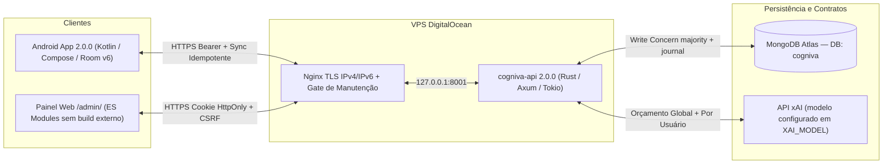

# Arquitetura do Ecossistema Cogniva 2.0

Este documento descreve a arquitetura unificada do **Cogniva `2.0.0`**, consolidando os contratos compartilhados, o backend Rust (`cogniva-api`), o painel administrativo web (`/admin/`), o aplicativo Android offline-first e a infraestrutura de entrega contínua.

---

## 1. Visão Geral de Componentes

- **Contratos Compartilhados ([`shared/`](../shared/)):** Fonte única de verdade validada em Python, Rust, Node.js e Kotlin:
  - [`shared/knowledge-catalog.json`](../shared/knowledge-catalog.json): Catálogo canônico unificado (`schema_version: 2`, `catalog_version: 2`) com troncos (`icon_key`), disciplinas (`trunk_links` com `default_weight`), assuntos e subassuntos.
  - [`shared/exam-templates.json`](../shared/exam-templates.json): Templates globais oficiais de concursos (`CPNU`, `RFB`, `BNDES`, `AFT`).
  - [`shared/domain-contracts.json`](../shared/domain-contracts.json): Vetores normativos (`contract_version: 3`) de revisão JCS SHA-256, cálculo de domínio, pontuação líquida ponderada, curvas SRS e fuso de estudo (`America/Sao_Paulo`, `UTC-3`).
  - [`shared/schemas/question-contracts.schema.json`](../shared/schemas/question-contracts.schema.json): Contrato JSON Schema 2020-12 de questões 100% V2, sugestões de classificação, compatibilidade e avaliações discursivas.

---

## 2. Identidade, Autenticação e Sessões Nativas

O Cogniva 2.0 opera com autenticação 100% própria, sem dependência de provedores externos ou bots de terceiros:

1. **Modo Convidado Imediato (`POST /api/v1/auth/guest`):**
   - Permite estudar imediatamente no Android com `user_id` exclusivo gerado pelo servidor (ou fallback local offline até a primeira conexão).
2. **Cadastro com Upgrade *In-Place* (`POST /api/v1/auth/register`):**
   - Quando o estudante envia um token `Bearer` de convidado ao criar sua conta com e-mail e senha (mínimo de 10 caracteres), o servidor promove **o mesmo `user_id`**, preservando 100% das tentativas, revisões SRS e grades locais/remotas.
   - Senhas são derivadas exclusivamente com **`Argon2id`** e sal aleatório criptográfico.
3. **Login e Sessões Revogáveis (`POST /api/v1/auth/login`, `POST /api/v1/auth/logout`, `GET /api/v1/auth/me`):**
   - Cada login cria um registro revogável na coleção `sessions` (TTL de 30 dias) e assina um JWT HS256 vinculado ao `sid` da sessão.
   - No Android, o token é persistido cifrado em repouso via **Android Keystore (`AES/GCM/NoPadding`)**.
   - No `/admin/`, a sessão utiliza cookie `__Host-` / `cogniva_web_session` com `HttpOnly`, `SameSite=Strict`, `Secure` (fora de loopback) e verificação estrita de `Origin` + cabeçalho `X-Cogniva-CSRF: 1` em mutações.
4. **Papéis (`student` vs. `admin`):**
   - Contas cujo e-mail consta em `ADMIN_EMAILS` recebem `role = "admin"` automaticamente no registro/login, ou podem ser promovidas via CLI: `cogniva-api --grant-admin <email>`.

---

## 3. Modelagem no Banco `cogniva` (MongoDB)

| Coleção | Responsabilidade Arquitetural |
| :--- | :--- |
| `usuarios` | Perfil da conta, credenciais (`email`, `password_hash`, `role`, `is_guest`), metas diárias e `active_contest_ids`. |
| `sessions` | Sessões ativas e revogáveis (`sid`, `user_id`, `client`, `expires_at`, `revoked_at`). |
| `todasQuestoes` | Acervo 100% normalizado em `schema_version = 2`, com `content_revision` JCS SHA-256, `classification`, `validity`, `origins`, caches pedagógicos e `ai_resource_meta`. |
| `exam_templates` | Templates globais administrados pelo `/admin/`, versionados por `revision`. |
| `user_exams` | Grades individuais por estudante (`owner_user_id`), com rastreamento de `template_source_id`, `template_revision_synced` e `is_customized`. |
| `userActivityLog` | Histórico consolidado por `(user_id, question_id)` com `pastSessions` ordenadas cronologicamente e janela limitada para evitar crescimento de documento BSON, além de `user_attempt_receipts` idempotentes. |
| `question_reports` | Reportes de problemas em questões isolados por `user_id` denunciante (`OPEN`, `RESOLVED`, `DISMISSED`), impedindo que o reporte de um aluno oculte questões para os demais. |
| `knowledge_catalog_*` | Snapshots imutáveis (`versions`), ponteiro ativo (`head`), auditoria de ativações (`activations`) e rascunhos colaborativos (`catalog_editor_drafts`). |
| `question_classification_suggestions` | Propostas de classificação IA V2 pendentes de revisão humana (`PENDING`, `ACCEPTED`, `REJECTED`, `STALE`). |
| `ai_daily_quotas` | Controle atômico de orçamento diário por usuário e teto global (`global:<YYYY-MM-DD>`). |

> **Migração Read-Only do Legado:** O banco histórico `CNU` nunca é escrito pela aplicação `2.0.0`. O script [`scripts/migrate_cnu_to_cogniva.py`](../scripts/migrate_cnu_to_cogniva.py) lê `CNU.todasQuestoes` em modo estritamente *read-only*, converte documentos V1 para o contrato V2 canônico e grava de forma idempotente em `cogniva.todasQuestoes`.

---

## 4. Sincronização Offline-First e Simetria Rust ↔ Kotlin

1. **Identidade Canônica de Conteúdo (`content_revision`):**
   - Tanto o backend Rust ([`models/question.rs`](../backend-rust/src/models/question.rs)) quanto o app Android ([`QuestionCacheMapping.kt`](../android-app/app/src/main/java/br/com/concursoprep/app/data/local/QuestionCacheMapping.kt)) e os validadores Python ([`scripts/question_contracts.py`](../scripts/question_contracts.py)) computam `SHA-256(JCS({question_type, question, answers, correct_answer_indices, grading}))` em conformidade exata com a RFC 8785.
2. **Templates Globais vs. Grades Pessoais (`ADR-06`):**
   - Se `user_exams.is_customized == false`, atualizações publicadas no template global em `/admin/` são refletidas automaticamente na grade do estudante.
   - Se `user_exams.is_customized == true`, a grade personalizada jamais é sobrescrita; a API sinaliza `upstream_update_available = true`, permitindo adoção voluntária via `POST /api/v1/exams/:id/adopt-template`.
   - Alterações em `is_active_in_ladder` sincronizam atomicamente `usuarios.active_contest_ids`.
3. **Banco Local Room v6 e Troca Segura de Conta:**
   - Cada conta no Android possui seu arquivo SQLite isolado (`cogniva-<userId>.db`), com migrações aditivas `1 → 2 → 3 → 4 → 5 → 6`.
   - A troca de conta aguarda a drenagem completa dos mutexes de sincronização (`repository.awaitIdleForClose()`) antes de fechar a instância anterior do Room.
4. **Questões Discursivas (`OPEN_ENDED`):**
   - Validadas e preservadas no banco V2 com rubrica estruturada para expansão futura, exibindo aviso explícito de modo preparatório nas telas de cadastro/edição e permanecendo excluídas de todas as filas de prática objetiva.

---

## 5. Governança de IA (xAI) e Operação Segura

- **Configuração Explícita:** Quando `XAI_API_KEY` está presente, `XAI_MODEL` é obrigatório na inicialização (sem *hardcode* de nomes de modelo no código-fonte).
- **Dupla Proteção de Orçamento:** Reserva atômica simultânea no limite individual (`XAI_DAILY_USER_LIMIT`, padrão `120/dia`) e no teto global do sistema (`XAI_DAILY_GLOBAL_LIMIT`, padrão `500/dia`), com estorno automático (`release_tutor`) caso a requisição HTTP à xAI falhe ou retorne payload inválido.
- **Promoção Atômica e OTA:** `deploy/promote.py` valida saúde, executa `--prepare-question-storage`, exercita rollback real sem mascarar falhas e publica o APK assinado com `applicationId = "br.com.concursoprep.app"` fora de qualquer camada de compressão dinâmica.
