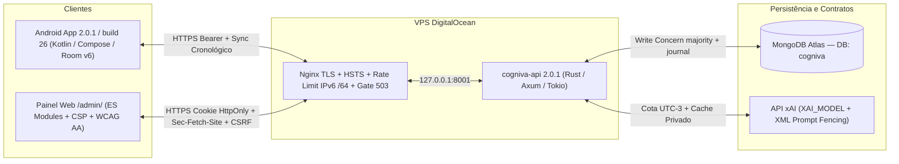

# Arquitetura do Ecossistema Cogniva 2.0

Este documento descreve a arquitetura unificada do **Cogniva `2.0.1`** (`build 26`), consolidando os contratos compartilhados, o backend Rust (`cogniva-api`), o painel administrativo web (`/admin/`), o aplicativo Android *offline-first*, a governança LGPD e a infraestrutura de entrega contínua.

---

## 1. Visão Geral de Componentes

- **Contratos Compartilhados ([`shared/`](../shared/)):** Fonte única de verdade validada em Python, Rust, Node.js e Kotlin:
  - [`shared/knowledge-catalog.json`](../shared/knowledge-catalog.json): Catálogo canônico unificado (`schema_version: 2`, `catalog_version: 2`) com troncos (`icon_key`), disciplinas (`trunk_links` com `default_weight`), assuntos e subassuntos.
  - [`shared/exam-templates.json`](../shared/exam-templates.json): Templates globais oficiais de concursos (`CPNU`, `RFB`, `BNDES`, `AFT`).
  - [`shared/domain-contracts.json`](../shared/domain-contracts.json): Vetores normativos (`contract_version: 3`) de revisão JCS SHA-256, cálculo de domínio, pontuação líquida ponderada, curvas SRS e fuso de estudo (`America/Sao_Paulo`, `UTC-3`).
  - [`shared/schemas/question-contracts.schema.json`](../shared/schemas/question-contracts.schema.json): Contrato JSON Schema 2020-12 de questões 100% V2 (com validação estrita de URIs `^https?://`, limites `exam_year` `1900..=2200` e `concursos <= 50`), sugestões de classificação, compatibilidade e avaliações discursivas.

---

## 2. Identidade, Autenticação Nativa e Conformidade LGPD

O Cogniva 2.0 opera com autenticação 100% própria e governança integral de dados pessoais ([`PRIVACY.md`](../PRIVACY.md) e [`SECURITY.md`](../SECURITY.md)):

1. **Modo Convidado Imediato (`POST /api/v1/auth/guest`):**
   - Permite estudar imediatamente no Android com `user_id` exclusivo protegido por limitador de taxa por IP.
2. **Cadastro com Upgrade *In-Place* (`POST /api/v1/auth/register`):**
   - Ao criar conta com e-mail e senha (8–128 caracteres) enviando o token `Bearer` de convidado, o servidor promove **o mesmo `user_id`**, preservando 100% das tentativas, revisões SRS e grades locais/remotas.
   - Senhas são derivadas exclusivamente com **`Argon2id`** e sal aleatório criptográfico.
3. **Login e Sessões Revogáveis (`POST /api/v1/auth/login`, `POST /api/v1/auth/logout`, `GET /api/v1/auth/me`):**
   - Cada login grava registro revogável na coleção `sessions` (com índice TTL em `expires_at`) e emite JWT HS256 vinculado ao `sid`.
   - No Android, credenciais são cifradas em repouso via **Android Keystore (`AES/GCM/NoPadding`)** com `android:allowBackup="false"`.
   - No `/admin/`, a sessão utiliza cookie `cogniva_web_session` com `HttpOnly`, `SameSite=Strict`, `Secure`, checagem `Sec-Fetch-Site`, validação de esquema + origem (`X-Forwarded-Proto` + `Origin`) e cabeçalho `X-Cogniva-CSRF: 1`.
4. **Exclusão Física de Dados Pessoais — LGPD Art. 18 (`DELETE /api/v1/auth/account`):**
   - Confirmada com `{"confirm": "EXCLUIR"}` no app Android ou via API, elimina fisicamente todos os registros pessoais do titular no banco `cogniva` e no dispositivo, anonimiza eventuais reportes em `reportedQuestoes` e **preserva 100% do acervo compartilhado** (`todasQuestoes`, `question_revision_events`, `knowledge_catalog_*` e `exam_templates`).

---

## 3. Modelagem no Banco `cogniva` (MongoDB)

| Coleção | Responsabilidade Arquitetural |
| :--- | :--- |
| `usuarios` | Perfil da conta, credenciais (`email`, `password_hash`, `role`, `is_guest`), metas diárias e `active_contest_ids`. |
| `sessions` / `auth_rate_limits` | Sessões ativas/revogáveis e janelas anti-força-bruta com expiração automática via índices TTL. |
| `todasQuestoes` | Acervo compartilhado 100% normalizado em `schema_version = 2`, com `content_revision` JCS SHA-256, `classification`, `validity`, `origins`, caches impessoais e `ai_resource_meta`. |
| `exam_templates` | Templates globais administrados pelo `/admin/`, versionados por `revision`. |
| `user_exams` / `exam_revisions` | Grades individuais por estudante (`owner_user_id`), com rastreamento de `template_source_id`, `template_revision_synced` e `is_customized`. |
| `userActivityLog` / `attempt_receipts` | Histórico consolidado por `(user_id, question_id)` com replay cronológico de tentativas *offline* fora de ordem (`client_answered_at`), janela ordenada em `pastSessions` e recibos idempotentes. |
| `reportedQuestoes` | Reportes de problemas em questões isolados por denunciante enquanto abertos e anonimizáveis sob exclusão LGPD. |
| `knowledge_catalog_*` | Snapshots imutáveis (`versions`), ponteiro ativo (`head`), auditoria de ativações e rascunhos colaborativos (`catalog_editor_drafts`). |
| `question_classification_suggestions` | Propostas de classificação IA V2 pendentes de revisão humana (`PENDING`, `ACCEPTED`, `REJECTED`, `STALE`). |
| `tutor_budgets` | Controle atômico de orçamento diário por usuário e teto global no fuso `America/Sao_Paulo` (`UTC-3`). |

---

## 4. Sincronização Offline-First e Simetria Rust ↔ Kotlin

1. **Identidade Canônica de Conteúdo (`content_revision`):**
   - Python, Rust e Kotlin computam `SHA-256(JCS({question_type, question, answers, correct_answer_indices, grading}))` em conformidade estrita com a RFC 8785.
2. **Replay Cronológico e SRS Consistente:**
   - O cálculo de intervalo no motor SRS aplica bônus sobre a sequência consecutiva atual (`streak_atual`), e lotes de sincronização offline com `client_answered_at` reordenam e reprocessam transições cronologicamente sem regredir `ultima_resposta_em`.
3. **Banco Local Room v6, Simulados Duráveis e Troca Segura de Conta:**
   - Isolamento em bancos SQLite por conta (`cogniva-<userId>.db`, migrações `1 → 6` com schema exportado), consultas em lote (`learningForQuestions`), persistência atômica de simulados em escopo sobrevivente à navegação + rascunho contra morte de processo e isolamento de falhas entre sincronização de perfil e sincronização de tentativas.

---

## 5. Governança de IA (xAI) e Entrega Contínua

- **Defesa de Prompt e Privacidade:** Entradas não confiáveis cercadas por XML (`<untrusted_student_input>`, `<untrusted_raw_source>`) e proibição de escrita em cache compartilhado quando há `user_note` ou resposta pessoal.
- **Pipeline Imutável:** `validate.yml` exige `cargo clippy -- -D warnings`, testes de integração em MongoDB sintético, testes Node.js do `/admin/` e testes JVM/Lint/Paparazzi Android; `deploy.yml` executa emulador API 35, assina o APK com chave privada v2/v3, valida `SHA256SUMS`, roda `rollback-drill` e promove atomicamente via `deploy/promote.py`.
