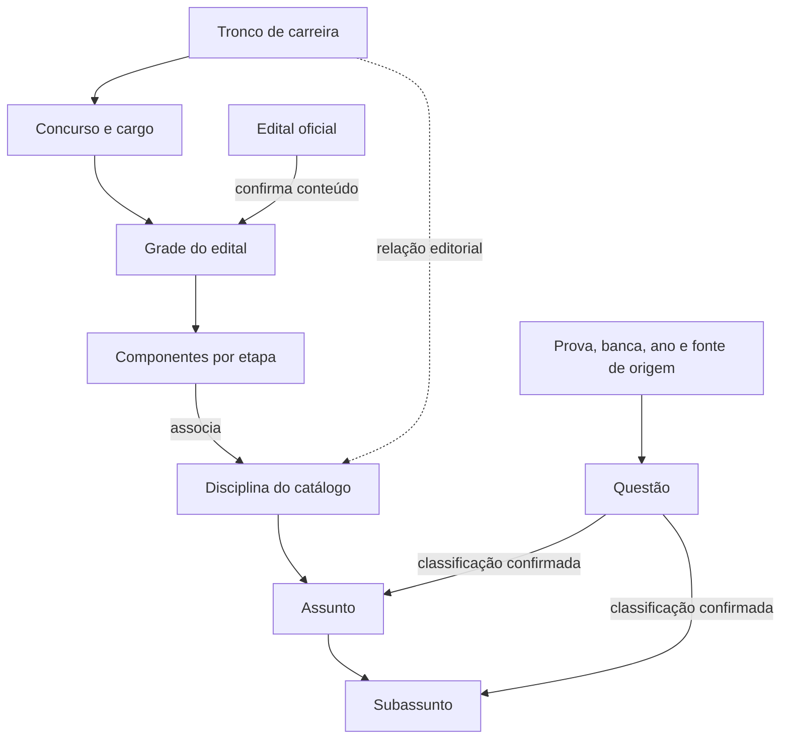

# Estrutura de estudos e conteúdo no Cogniva

O Cogniva conecta uma organização de estudos por concurso a um catálogo de conhecimento compartilhado. O guia na administração web e em **Ajustes → Ajuda**, no Android, usa estes significados.

| Entidade | Relação e responsabilidade |
| --- | --- |
| Tronco de carreira | Agrupa uma área de carreira e sugere disciplinas relacionadas. Um concurso declara um tronco; uma disciplina pode se relacionar a vários. |
| Concurso | Oportunidade e cargo da conta, com instituição, banca, situação e previsão de prova. Possui uma grade de estudo. |
| Edital | Referência oficial do conteúdo do concurso. A grade pode ser preparada antes de sua publicação; a confirmação oficial é explícita e versionada. |
| Grade do edital | Organização operacional de componentes e seus assuntos para o concurso, incluindo a base pré-edital. |
| Componente | Ocorrência de uma disciplina em uma etapa da grade, com identidade local, grupo, peso, quantidade e assuntos próprios. |
| Disciplina | Identidade canônica do catálogo, compartilhada entre troncos, componentes e questões. |
| Assunto | Conteúdo de uma disciplina, com identidade própria e sem pai de assunto. |
| Subassunto | Detalhe de um assunto da mesma disciplina, com identidade própria e referência ao pai. |
| Questão | Enunciado, alternativas/gabarito ou rubrica, origem, classificação por conteúdo e validade. Sua origem é independente de sua compatibilidade com outras grades. |

Exemplo: Língua Portuguesa pode aparecer na objetiva e na discursiva de um mesmo concurso. São dois componentes com pesos e assuntos diferentes, que apontam à mesma disciplina. Uma questão de interpretação de textos pode ser usada em mais de um concurso quando sua classificação confirmada corresponde à grade e as regras de compatibilidade permitem. Ter vindo de uma prova fiscal não a torna automaticamente exclusiva dessa carreira.

O vínculo editorial de um tronco não certifica cobertura de edital. Assunto pai não inclui subassuntos automaticamente; a grade faz a inclusão explícita. Nomes e aliases ajudam na busca; identidades e decisões confirmadas sustentam os vínculos. Nenhuma dessas melhorias de interface reclassifica questões ou reescreve grades, catálogo e histórico existentes.

Regras detalhadas: [catálogo](CATALOGO-CONHECIMENTOS.md), [questões v2](SCHEMA-QUESTOES-V2.md), [inserção](INSERCAO-QUESTOES.md) e [administração](ADMIN-WEB.md).
