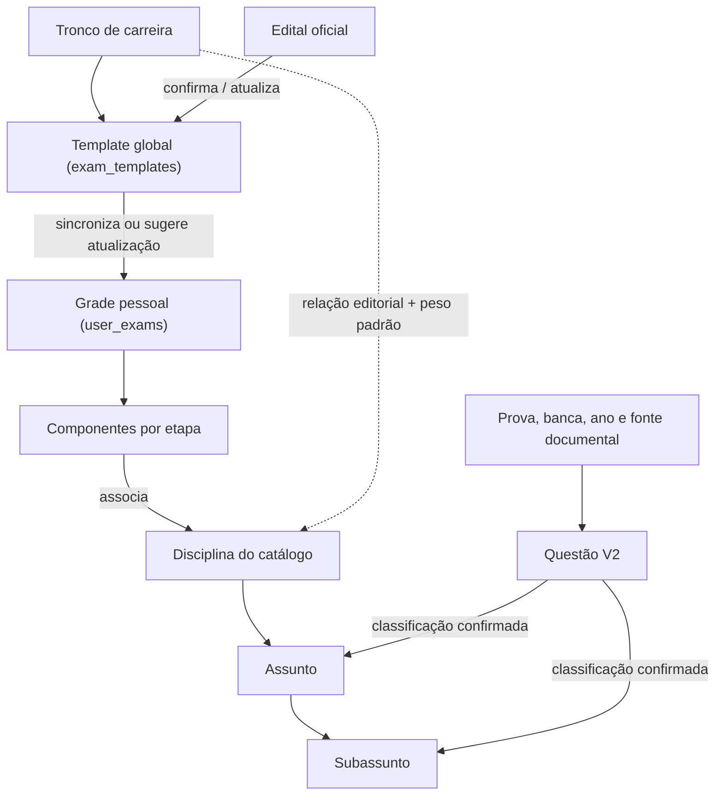

# Estrutura de Estudos e Conteúdo no Cogniva

O Cogniva conecta o planejamento individual de concursos por estudante a templates oficiais e a um catálogo compartilhado de conhecimentos. A Central de Ajuda do `/admin/` e a seção **Ajustes → Ajuda** no Android utilizam exatamente estas definições.

| Entidade | Relação e responsabilidade |
| :--- | :--- |
| **Tronco de carreira** | Agrupa uma família de carreiras (`fiscal`, `controle`, `tribunais` etc.) e sugere disciplinas nucleares e complementares com pesos editoriais padrão. |
| **Template global de concurso** | Estrutura oficial base (`exam_templates`, ex.: `CPNU`, `RFB`, `BNDES`, `AFT`) mantida pelos administradores no `/admin/`. |
| **Grade pessoal do estudante** | Instância individual (`user_exams`) na escada de estudos do aluno. Recebe atualizações automáticas do template global enquanto não for customizada; se personalizada, preserva as edições do aluno e sinaliza quando há nova revisão oficial disponível (`Adotar template`). |
| **Edital oficial** | Documento normativo público do certame. Quando publicado, permite comparar tópicos confirmados, novos e arquivados sem apagar o histórico já estudado. |
| **Componente por etapa** | Ocorrência de uma disciplina em uma etapa específica da prova (ex.: `1ª etapa`, `Discursiva`), com `local_subject_id`, peso, número de questões e lista própria de tópicos. |
| **Disciplina** | Identidade canônica global (`subject_id` no catálogo), compartilhada entre troncos, templates, grades e questões. |
| **Assunto** | Conteúdo raiz de uma disciplina (`topic_id`, `parent_topic_id = null`). |
| **Subassunto** | Detalhamento específico subordinado a um assunto da mesma disciplina (`parent_topic_id` preenchido). |
| **Questão (V2)** | Enunciado, alternativas/gabarito objetivo ou rubrica discursiva, origem documental, classificação canônica confirmada e status de validade. |

## Regras Fundamentais de Coerência

1. **Reaproveitamento entre Concursos:** Uma mesma disciplina pode aparecer em múltiplas etapas de um concurso (com pesos e tópicos distintos) e em vários concursos da escada do estudante. O domínio confirmado em um tópico canônico avança simultaneamente todas as grades que cobram aquele tópico.
2. **Independência entre Origem e Classificação:** O fato de uma questão ter sido aplicada originalmente por determinada banca ou órgão registra sua **origem documental**, mas o que define sua elegibilidade para estudo em qualquer concurso é sua **classificação por conteúdo** (`subject_id` / `topic_id`) e sua **validade** (`CURRENT` / `UNKNOWN`).
3. **Treino Direcionado:** No Android, o estudante pode praticar toda a disciplina do componente (**Treinar Disciplina**) ou filtrar especificamente um tópico/subassunto da árvore (**Treinar Tópico**).

Consulte os contratos detalhados em [`CATALOGO-CONHECIMENTOS.md`](CATALOGO-CONHECIMENTOS.md), [`SCHEMA-QUESTOES-V2.md`](SCHEMA-QUESTOES-V2.md), [`INSERCAO-QUESTOES.md`](INSERCAO-QUESTOES.md) e [`ADMIN-WEB.md`](ADMIN-WEB.md).
