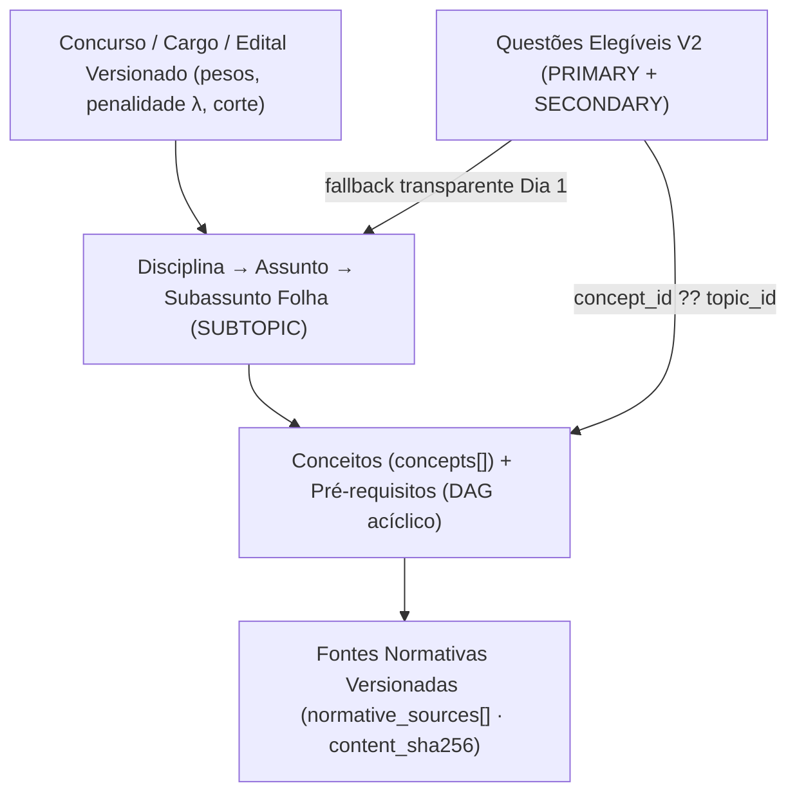

# Motores de Decisão, Grafo de Conceitos e Core Loop Diário (`2.2.0`)

Este documento especifica a arquitetura de decisão pedagógica e de estratégia de prova do **Cogniva `2.2.0`** (`build 28`, `contract_version: 4`), implementada com simetria matemática exata entre o backend Rust ([`backend-rust/src/services/`](../backend-rust/src/services/)) e o cliente Android *offline-first* ([`PerformanceEngines.kt`](../android-app/app/src/main/java/br/com/concursoprep/app/domain/exam/PerformanceEngines.kt)).

---

## 1. Princípios Epistemológicos e Não-Punitivos

1. **Evidência Auditável antes de Afirmação de Domínio:**
   - Responder repetidas vezes à mesma questão jamais confere competência comprovada (`VERIFIED_COMPETENCE`). O sistema exige pelo menos **`distinct_questions >= 3`** unidades independentes, precisão acumulada `>= 80%`, retenção espaçada verificada (`>= 24h`) e confiança `>= 2`.
2. **Âncora Concreta sem Punição:**
   - A data da prova e a grade ativa exibem objetivamente **o que falta demonstrar até o exame** (`comprovados · em consolidação · sem evidência`).
   - Pré-requisitos pendentes funcionam como **impulso suave de priorização** (`0.55^k`), nunca como bloqueio rígido de acesso. Não há penalidade gamificada por ausência nem probabilidades especulativas de aprovação sem validação.
3. **Aproveitamento Integral do Acervo Elegível V2:**
   - Todas as questões objetivas com `classification.state == "CONFIRMED"` e `validity.status == "CURRENT"` alimentam igualmente os 5 motores de decisão, o diagnóstico, os simulados e a reserva de validação (**Holdout 20%**).

---

## 2. Grafo de Conhecimento Vinculado ao Edital

A camada canônica separa a estrutura de conhecimento da camada de concurso/edital (`exam_templates` / `user_exams`):

- **Preservação do Hash Gênese (`af2d711b...`):** [`shared/knowledge-catalog.json`](../shared/knowledge-catalog.json) permanece imutável como raiz da cadeia `knowledge_catalog_activations` em produção; conceitos e fontes normativas iniciais residem em [`shared/knowledge-concepts-seed.json`](../shared/knowledge-concepts-seed.json) e em revisões subsequentes do catálogo validadas por [`shared/knowledge-catalog.schema.json`](../shared/knowledge-catalog.schema.json).
- **Validação DAG Estrita (Ordenação Topológica de Kahn):** [`scripts/knowledge_catalog.py`](../scripts/knowledge_catalog.py) e [`catalog_editor.rs`](../backend-rust/src/services/catalog_editor.rs) rejeitam auto-dependências e ciclos indiretos em `prerequisite_concept_ids[]`.
- **Fallback Transparente (`resolve_unit_id`):** Quando uma questão ainda não possui `concept_id` explícito em `classification.links[]`, o motor projeta automaticamente sobre o `SUBTOPIC` folha (`topic_id`), mantendo 100% do acervo operacional desde o primeiro dia.
- **Rastreamento de Mudança Normativa (`Hash Diff`):** Alterações de `content_sha256` em `normative_sources[]` sinalizam no `/admin/` (`detectImpactedQuestionsBySourceHash`) apenas os conceitos e questões dependentes daquela fonte para revisão humana.

---

## 3. Especificação Matemática dos 5 Motores + Holdout 20%

Todos os cálculos são verificados bit a bit contra os vetores normativos de [`shared/domain-contracts.json`](../shared/domain-contracts.json) (`contract_version: 4`) em Python, Rust ([`contract_tests.rs`](../backend-rust/src/contract_tests.rs)) e Kotlin ([`SharedDomainContractTest.kt`](../android-app/app/src/test/java/br/com/concursoprep/app/SharedDomainContractTest.kt)).

### 3.1. Motor de Diagnóstico (`diagnostic_engine.rs` / `DiagnosticEngine`)
Classifica o estado de cada unidade (`concept_id ?? topic_id`) cruzando acerto, confiança explícita, histórico prévio e desafio opcional de evidência (`evidence_challenge`):
- `OVERCONFIDENCE_ERROR`: último item incorreto com `confidence >= 3` (ou `confidence >= 2` com falha no desafio de evidência).
- `CONCEPTUAL_ERROR`: último item incorreto sem acerto espaçado anterior verificado ou com falha explícita na identificação do fundamento.
- `RETRIEVAL_FAILURE`: erro após histórico prévio comprovado, indicando esquecimento temporal.
- `VERIFIED_COMPETENCE`: último item correto com `confidence >= 2`, `distinct_questions >= 3`, `has_spaced_retention == true` e acurácia não-em-branco `>= 80%`.
- `INSUFFICIENT_EVIDENCE`: amostra insuficiente (`distinct_questions < 3` ou sem retenção espaçada).

### 3.2. Motor de Retenção Contínua (`retention_engine.rs` / `RetentionEngine`)
Modela estabilidade de memória $S$ (em dias) e dificuldade $D \in [1, 10]$ a partir das respostas reais e da latência de resolução:

$$R(t, S) = \left(1 + \frac{19}{81}\cdot\frac{t}{S}\right)^{-0{,}5}$$

- Em $t = S$, $R(S, S) = 0{,}90$ exatamente.
- **Proteção Anti-Chute:** Acertos com `confidence <= 1` limitam $S \in [1{,}0;\; 1{,}5]$ dia, impedindo que acertos casuais empurrem conceitos frágeis para horizontes longos.

### 3.3. Motor de Priorização e Intercalação (`prioritization_engine.rs` / `PrioritizationEngine`)
Ordena unidades pela utilidade marginal esperada por minuto de estudo:

$$U(u) = \frac{w_{\text{edital}} \cdot w_{\text{incidência}} \cdot \text{gap}(u)}{\tau_{\min}(u)} \cdot 0{,}55^{\min(3,\, k_{\text{prereq}})} \cdot \bigl(1 + 0{,}15\min(4,\, d_{\text{dep}})\bigr)$$

onde $\text{gap}(u) = \text{clamp}(1 - m_{\text{eff}}, 0{,}05, 1{,}0)$ desconta amostras com menos de 3 questões distintas. Na rota adaptativa (`ADAPTIVE_LOOP`), `interleave_buckets` intercala determinísticamente **~40% revisões próximas do esquecimento**, **~40% lacunas diagnósticas** e **~20% conteúdos novos de alto impacto**.

### 3.4. Motor de Calibração Beta-Binomial (`calibration_engine.rs` / `CalibrationEngine`)
Estima a probabilidade calibrada real $\hat{p}$ do candidato separadamente por formato (`TRUE_FALSE` vs. `MULTIPLE_CHOICE`) e faixa de confiança (`1..3`), combinando prior informativo de peso $N_0 = 6$ ($\mu_0 \in \{0{,}50; 0{,}65; 0{,}85\}$ para C/E e $\{0{,}20; 0{,}45; 0{,}85\}$ para múltipla escolha) com acertos/tentativas observados:

$$\hat{p} = \frac{\alpha_0 + k}{\alpha_0 + \beta_0 + n}, \qquad \sigma = \sqrt{\frac{\alpha\beta}{(\alpha+\beta)^2(\alpha+\beta+1)}}$$

### 3.5. Motor de Estratégia de Prova e Holdout 20% (`strategy_engine.rs` / `StrategyEngine`)
- **Reserva Determinística Holdout (20%):** Quando o pool elegível possui `pool_size >= 5`, `SHA-256("cogniva-holdout-v1:<user_id>:<question_id>") mod 5 == 0` reserva 20% das questões fora do treino adaptativo cotidiano (`ADAPTIVE_LOOP`) para verificação limpa de transferência em `SIMULADO` e `STRATEGY_BATTERY`.
- **Fallback Cross-Banca Automático:** Quando uma cota de simulado não atinge o total apenas na banca-alvo, o seletor busca automaticamente questões equivalentes de outras bancas no mesmo tópico canônico (`is_borrowed_analogous = true`), eliminando falhas HTTP `400` por escassez pontual de banca.
- **Decisão Responder vs. Omitir ($VE$ e Nota de Corte):** Para penalidade $\lambda \ge 0$ por erro:

$$VE(\text{responder}) = (1 + \lambda)\hat{p} - \lambda, \qquad p^* = \frac{\lambda}{1 + \lambda}$$

Para provas estilo Cebraspe ($\lambda = 1{,}0$), $VE = 2\hat{p} - 1$ e $p^* = 0{,}50$. Na reta final da bateria (`remaining_fraction <= 0.35`) com nota de corte cadastrada, o limiar efetivo ajusta-se para `PROTECT_MARGIN` ($p^* + 0{,}05$ quando `>= +6%` acima do corte) ou `CALCULATED_RISK` ($p^* - 0{,}04$ quando `<= -6%` abaixo do corte).

### 3.6. Motor de Fadiga (`fatigue_engine.rs` / `FatigueEngine`)
Estima variação de desempenho entre o bloco inicial (`<= 45 min`) e o bloco prolongado (`> 45 min`) com regularização empírica ($\kappa = \frac{n_{\text{late}}}{n_{\text{late}} + 40}$). Permanece estritamente em **`INSUFFICIENT_EVIDENCE`** enquanto o aluno não acumular ao menos **3 simulados longos contínuos sem interrupção** (`!session_interrupted`) e **120 itens cronometrados** (`>= 30` iniciais e `>= 30` tardios).

---

## 4. Core Loop Diário de 60 Minutos

| Bloco | Duração Sugerida | Mecânica no Produto (`GET /api/v1/study/next-action` + Android) |
| :--- | :--- | :--- |
| **01 · Entrada Inteligente** | `0–5 min` | Card no topo de **Hoje**: *"Comece com uma questão. Você pode encerrar após responder."* Abre 1 questão prioritária sem fricção de escolha. |
| **02 · Treinamento Adaptativo** | `5–45 min` | Convite pós-1ª questão para rota curta intercalada (`ADAPTIVE_LOOP`, 40/40/20), com confiança explícita obrigatória, gabarito imediato, RAG normativo estrito e **Diagnóstico de Evidência (Opcional)** em erros. |
| **03 · Estratégia de Prova** | `45–60 min` | Bateria cronometrada (`STRATEGY_BATTERY` / `SIMULADO`) com regras exatas da banca, botão explícito **Deixar em Branco (Omitir · 0 pt)** e consolidação na aba **Progresso**. |
