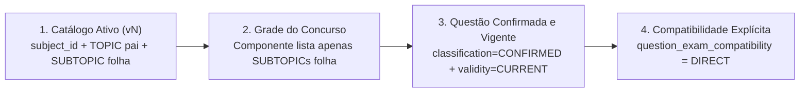

# Guia Completo: Criação e Importação de Pacotes de Questões Prontas

Este guia documenta, ponta a ponta, como estruturar a árvore programática de qualquer disciplina no Cogniva (`Disciplina → Assunto → Subassunto`) e como produzir pacotes JSON de questões que já entram no servidor **100% prontas para estudo e rastreamento de domínio** — classificadas (`CONFIRMED`), vigentes (`CURRENT`), vinculadas ao concurso (`DIRECT`) e imediatamente sorteáveis no aplicativo Android e no painel [`/admin/`](ADMIN-WEB.md).

Consulte também:
- [`ESTRUTURA-ESTUDOS.md`](ESTRUTURA-ESTUDOS.md) — relação entre troncos, templates globais, grades pessoais, componentes e catálogo;
- [`CATALOGO-CONHECIMENTOS.md`](CATALOGO-CONHECIMENTOS.md) — regras formais do catálogo unificado e imutabilidade de identidades;
- [`SCHEMA-QUESTOES-V2.md`](SCHEMA-QUESTOES-V2.md) — contratos V2/V2.1, hashes RFC 8785 JCS e política centralizada de elegibilidade (`evaluate_question_eligibility`);
- [`INSERCAO-QUESTOES.md`](INSERCAO-QUESTOES.md) — endpoints `assist`, `preview` e `commit`, atomicidade e idempotência.

---

## 1. Os 4 Pilares de uma Questão "Pronta para Estudo e Rastreamento"

Gravar um documento em `cogniva.todasQuestoes` **não** o torna elegível para treino nem rastreável no Edital Verticalizado. Para que um pacote recém-importado funcione imediatamente em **Treinar Disciplina**, **Treinar Tópico**, **Simulado Ponderado** e no cálculo percentual de cobertura/domínio (`GET /api/v1/learning/state`), os **quatro pilares abaixo** precisam estar atendidos simultaneamente:



| Pilar | Onde reside | Requisito Exato | O que ocorre se faltar |
| :--- | :--- | :--- | :--- |
| **1. Taxonomia Canônica** | `knowledge_catalog_versions` / `knowledge_catalog_head` | `subject_id`, `TOPIC` raiz (`parent_topic_id: null`) e `SUBTOPIC` folha (`parent_topic_id: "<TOPIC_ID>"`) com `status = "ACTIVE"` na versão ativa em execução. | `preview` rejeita o lote por tópico inexistente ou inativo. |
| **2. Grade Alinhada** | `exam_templates` e `user_exams` | O componente da disciplina (ex.: `bcb2027-ef-ECON`) lista em `subject.topics` os **`SUBTOPIC`s folha** canônicos (sem `custom-*` órfãos nem mistura de `TOPIC` pai + `SUBTOPIC` filho). | Tópicos `custom-*` não acumulam `knowledge_evidence`; `TOPIC` pai misturado com filhos fica preso em `0%` e distorce a média da disciplina. |
| **3. Classificação + Validade** | `todasQuestoes` + `question_review_events` | `status = "ACTIVE"`, `classification.state = "CONFIRMED"` (1 link `PRIMARY` + `DIRECT`), `validity.status = "CURRENT"` e `scope = "CURRENT_KNOWLEDGE"` com revisão humana autenticada no servidor. | Itens com `UNCLASSIFIED` ou `validity.status = "UNKNOWN"` não entram em `questions_current` e são barrados na prática (`CLASSIFICATION_NOT_CONFIRMED` / `VALIDITY_NOT_CONFIRMED`). |
| **4. Vínculo com o Concurso** | `question_exam_compatibility` | Registro `status = "CONFIRMED"`, `relation = "DIRECT"`, apontando para `(exam_id, component_id, matched_topic_ids = [topic_id])` na revisão atual da grade. | Questão pode ficar fora de cotas estritas de simulado ou exigir inferência indireta (`EXAM_COMPATIBILITY_MISSING`). |

---

## 2. Modelagem da Hierarquia (`Disciplina → Assunto → Subassunto`)

### 2.1 Regra Crítica: Baseline do Repositório vs. Catálogo Ativo em Produção

- O arquivo [`shared/knowledge-catalog.json`](../shared/knowledge-catalog.json) (`catalog_version: 2`) é a **raiz imutável** da cadeia de ativação embutida no binário Rust (`catalog_runtime.rs`) e verificada em CI por [`scripts/tests/test_knowledge_catalog.py`](../scripts/tests/test_knowledge_catalog.py).
- **Nunca edite `shared/knowledge-catalog.json` manualmente para incrementar `catalog_version` em produção.** Toda inclusão de novas disciplinas, assuntos ou subassuntos no servidor deve avançar o catálogo em execução (`vN → vN+1`) via `POST /api/v1/admin/catalog/validate` → `POST /api/v1/admin/catalog/drafts` → `POST /api/v1/admin/catalog/activate` (pelo painel `/admin/` ou automaticamente por [`scripts/cogniva_import.py`](../scripts/cogniva_import.py)).

### 2.2 Convenção de Identificadores (`^[A-Z][A-Z0-9_]*$`)

Antes de criar qualquer ID, consulte sempre o catálogo ativo em execução (`GET /api/v1/catalog/knowledge` ou `GET /api/v1/admin/catalog/base`) e a listagem base em [`catalogo/CONHECIMENTOS.md`](catalogo/CONHECIMENTOS.md) para reaproveitar a disciplina canônica existente:

| Nível | Tipo no Catálogo | `parent_topic_id` | Padrão de ID Recomendado | Exemplo Real (`Finanças` / `Economia`) |
| :--- | :--- | :--- | :--- | :--- |
| **Disciplina** | `subjects[*]` | — | `<SIGLA>` | `MFIN`, `ECON`, `CONTAB`, `DIR_CONST`, `DIR_ADM`, `ESTAT`, `INFO`, `FIN_PUB` |
| **Assunto-Raiz** (item `1`, `2`, `3` do edital) | `topics[*]` com `kind: "TOPIC"` | `null` | `<SUBJECT_ID>_<NN>` | `MFIN_02`, `MFIN_03`, `ECON_01`, `ECON_02` |
| **Subassunto-Folha** (subitem `1.1`, `1.2` do edital) | `topics[*]` com `kind: "SUBTOPIC"` | `"<TOPIC_ID>"` | `<TOPIC_ID>_<NNN>` | `MFIN_02_001`, `MFIN_02_002`, `ECON_01_001` |

> **Nota sobre `<NN>` inicial:** verifique sempre quais prefixos `<SUBJECT_ID>_<NN>` já existem no catálogo ativo da disciplina (por exemplo, `MFIN_01` já era utilizado por tópicos introdutórios legados, razão pela qual a árvore nova do edital utilizou `MFIN_02` a `MFIN_09`). Nunca reutilize um `topic_id` existente para outro significado.

### 2.3 Invariante Obrigatória: Todo `TOPIC` Deve Ter ao Menos um `SUBTOPIC`

O validador do catálogo (`catalog_editor.rs` e [`scripts/knowledge_catalog.py`](../scripts/knowledge_catalog.py)) exige estritamente:
1. Profundidade máxima de **2 níveis de tópicos**: `TOPIC` (`parent_topic_id: null`) → `SUBTOPIC` (`parent_topic_id: "<TOPIC_ID>"`). Não existe sub-subtópico de 3º nível (`SUBTOPIC` nunca pode ser pai de outro tópico).
2. **Todo `TOPIC` deve possuir pelo menos um `SUBTOPIC` filho.** Caso contrário, a validação falha com `Assunto deve ter subassunto: <ID>`.

**Como modelar itens de edital sem subdivisões explícitas?**
- Exemplo real do edital de Finanças: `7 Riscos dos fatores sociais, ambientais e de governança (ESG)` não possuía subitens `7.1`, `7.2`.
- **Solução padrão:** crie o `TOPIC` pai (`MFIN_08`, `parent_topic_id: null`, `label: "7 Riscos dos fatores sociais, ambientais e de governança (ESG)"`) **e** um `SUBTOPIC` folha único (`MFIN_08_001`, `parent_topic_id: "MFIN_08"`, `label: "7 Riscos dos fatores sociais, ambientais e de governança (ESG)"`), classificando **todas** as questões no `SUBTOPIC` folha (`MFIN_08_001`).
- E se o edital tiver `1.2.1` (3º nível)? Agrupe no 2º nível com rótulo composto claro (ex.: `1.2.1 ...` como `SUBTOPIC` direto de `1 ...`), mantendo a árvore em 2 níveis (`TOPIC → SUBTOPIC`).

### 2.4 Unicidade de Nomes/Aliases (Normalização NFKD) e Renomeações

O servidor normaliza `label` e `aliases` removendo acentos (NFKD), convertendo para minúsculas e trocando pontuação por espaços simples:
- **Entre disciplinas (`subjects`)**: nenhum `label` ou `alias` pode colidir globalmente com outra disciplina.
- **Entre `TOPIC`s raiz da mesma disciplina**: escopo `(subject_id, null)` — dois `TOPIC`s da mesma disciplina não podem ter o mesmo texto normalizado.
- **Entre `SUBTOPIC`s irmãos**: escopo `(subject_id, parent_topic_id)` — dois `SUBTOPIC`s sob o **mesmo** `TOPIC` pai não podem colidir, mas `TOPIC`s pais diferentes *podem* ter subtópicos com nomes semelhantes (ex.: `5.1 Conceitos gerais` em pais distintos).
- **Ao renomear qualquer entidade existente**: mantenha obrigatoriamente o `label` anterior dentro do array `aliases` e incremente `revision` em `+1`.

---

## 3. Regra de Ouro do Rastreamento na Grade do Concurso (`exam_templates`)

No motor de progresso (`exam_engine.rs` no backend e `ConcursoRepository.kt` no Android):
- Cada entrada de `exam.subjects[*].topics` vira uma linha individual do **Edital Verticalizado** com seu próprio `%` de domínio, estágio (`NAO_INICIADO`, `QUESTOES`, `REVISAO`, `DOMINADO`) e botão **Treinar Tópico**.
- O domínio consolidado da **Disciplina** é a média aritmética dos `canonical_topic_id` não arquivados listados em `subject.topics` — **não há *rollup* implícito de `SUBTOPIC` para `TOPIC` pai dentro da lista plana do componente**.

Portanto, ao montar ou atualizar qualquer disciplina de um concurso:
1. **Classifique 100% das questões sempre no `SUBTOPIC` folha** (`MFIN_02_001`, `ECON_01_001`, etc.).
2. **Registre na grade do componente (`subject.topics`) exclusivamente os `SUBTOPIC`s folha**, usando `display_title` no formato `"<Assunto-Raiz> › <Subassunto>"`:
   - Exemplo: `"1 Características de operações e instrumentos do mercado financeiro e de capitais › 1.1 Títulos emitidos pelo Tesouro Nacional"`.
3. **Remova `custom-*` legados** (`canonical_topic_id: null`) quando substituir um rascunho pré-edital pela árvore canônica definitiva (`--replace-custom-placeholders`), preservando intacto o histórico de respostas do aluno.
4. **Agregação por Assunto-Raiz (`TOPIC`)**: como todo `SUBTOPIC` referencia seu `parent_topic_id` em `/api/v1/catalog/knowledge`, relatórios e painéis conseguem agregar tanto por subassunto (`1.1`) quanto por assunto-raiz (`1`) e disciplina (`Finanças`).

---

## 4. Contrato Exato do Pacote JSON de Questões

O importador oficial [`scripts/cogniva_import.py`](../scripts/cogniva_import.py) aceita dois formatos de arquivo JSON:

### 4.1 Formato A (Recomendado): Pacote Autodescritivo Completo (`target` + `taxonomy` + `items`)

Ideal para **novas disciplinas ou novos blocos do edital**, pois carrega no próprio arquivo os metadados do concurso, os `TOPIC`s/`SUBTOPIC`s que precisam existir no catálogo e questões de **um ou vários subtópicos** simultaneamente:

```json
{
  "package_version": 1,
  "target": {
    "exam_id": "c02bb92e-f015-4fae-8d52-92814babe02c",
    "subject_id": "ECON",
    "component_id": "bcb2027-ef-ECON",
    "replace_custom_placeholders": false
  },
  "taxonomy": {
    "parent_topics": [
      {
        "topic_id": "ECON_02",
        "subject_id": "ECON",
        "label": "1 Microeconomia",
        "aliases": ["Microeconomia"]
      }
    ],
    "subtopics": [
      {
        "topic_id": "ECON_02_001",
        "subject_id": "ECON",
        "parent_topic_id": "ECON_02",
        "label": "1.1 Teoria do consumidor, utilidade e demanda",
        "aliases": ["Teoria do consumidor"],
        "syllabus_display_title": "1 Microeconomia › 1.1 Teoria do consumidor, utilidade e demanda"
      },
      {
        "topic_id": "ECON_02_002",
        "subject_id": "ECON",
        "parent_topic_id": "ECON_02",
        "label": "1.2 Teoria da firma, custos e oferta",
        "aliases": ["Teoria da firma"],
        "syllabus_display_title": "1 Microeconomia › 1.2 Teoria da firma, custos e oferta"
      }
    ]
  },
  "items": [
    {
      "question_type": "TRUE_FALSE",
      "question": "Se as preferências de um consumidor são representadas pela função utilidade Cobb-Douglas U(x, y) = x^0,4 * y^0,6, submetida à restrição orçamentária p_x * x + p_y * y = m, a parcela da renda gasta com o bem x é constante e igual a 40%, independentemente de variações estritamente positivas em p_x, p_y ou m.",
      "answers": ["Certo", "Errado"],
      "correct_answer_indices": [0],
      "grading": null,
      "origin_kind": "AUTHOR_CREATED",
      "source_exam_code": null,
      "institution": null,
      "organizer": null,
      "exam_year": null,
      "question_number": null,
      "source_reference": null,
      "confirm_origin": false,
      "subject_id": "ECON",
      "topic_id": "ECON_02_001",
      "confirm_classification": true,
      "explanation": "Certo. Na maximização de U(x, y) = x^a * y^(1-a) sujeita a p_x * x + p_y * y = m (com 0 < a < 1), a condição de tangência TMS = p_x / p_y resulta nas demandas marshallianas x* = a * m / p_x e y* = (1 - a) * m / p_y. Logo, o dispêndio ótimo com x é p_x * x* = a * m, correspondendo exatamente à fração constante a = 0,40 (40%) da renda m. Referência: Mas-Colell, Whinston e Green, Microeconomic Theory, cap. 3.",
      "level": "Fácil"
    },
    {
      "question_type": "MULTIPLE_CHOICE",
      "question": "Uma firma competitiva opera no curto prazo com função custo total CT(q) = 100 + 10q + 2q^2, onde q >= 0 representa a quantidade produzida. Caso o preço de mercado do produto seja P = 50, o lucro econômico máximo de curto prazo dessa firma será igual a:",
      "answers": [
        "R$ 0,00, pois a firma deve encerrar as atividades no curto prazo.",
        "R$ 100,00.",
        "R$ 200,00.",
        "R$ 300,00.",
        "R$ 400,00."
      ],
      "correct_answer_indices": [1],
      "grading": null,
      "origin_kind": "AUTHOR_CREATED",
      "source_exam_code": null,
      "institution": null,
      "organizer": null,
      "exam_year": null,
      "question_number": null,
      "source_reference": null,
      "confirm_origin": false,
      "subject_id": "ECON",
      "topic_id": "ECON_02_002",
      "confirm_classification": true,
      "explanation": "Gabarito: 2ª alternativa (R$ 100,00). O custo marginal é CMg(q) = dCT/dq = 10 + 4q, estritamente crescente (d^2CT/dq^2 = 4 > 0). Igualando P = CMg(q): 50 = 10 + 4q => 4q = 40 => q* = 10 unidades. Em q* = 10, o custo variável médio vale CVMe(10) = (10*10 + 2*100)/10 = 30 <= P = 50, confirmando produção positiva no curto prazo. A receita total é RT(10) = 50 * 10 = R$ 500,00 e o custo total é CT(10) = 100 + 10(10) + 2(10^2) = 100 + 100 + 200 = R$ 400,00, resultando em lucro econômico máximo de RT - CT = R$ 100,00 (enquanto o excedente do produtor no curto prazo, antes de descontar o custo fixo de R$ 100,00, corresponde a R$ 200,00, distrator clássico da 3ª alternativa). Referência: Varian, Microeconomia: Princípios Básicos.",
      "level": "Média"
    }
  ]
}
```

### 4.2 Formato B: Array JSON Puro (`[ ... ]`)

Quando os `TOPIC`s e `SUBTOPIC`s já estão ativos no catálogo do servidor, o arquivo pode ser simplesmente um array JSON `[ {...}, {...} ]` em que cada item declara seu próprio `subject_id`, `topic_id` e `confirm_classification: true` (podendo misturar vários subtópicos da mesma disciplina ou de disciplinas distintas no mesmo arquivo).

### 4.3 Os 18 Campos Permitidos no Item Simplificado

O endpoint `POST /api/v1/admin/questions/import/preview` possui lista branca estrita (`question_import.rs`). **Qualquer chave fora das 18 abaixo gera erro `400 Bad Request` (`Campo desconhecido no formato simplificado`)**:

| Campo | Tipo JSON | Regra Estrita para Pacotes Prontos |
| :--- | :--- | :--- |
| `question_type` | `string` | `"TRUE_FALSE"` ou `"MULTIPLE_CHOICE"` (use `"OPEN_ENDED"` apenas para acervo discursivo preparatório, que não entra na prática objetiva). |
| `question` | `string` | Enunciado completo, claro e autossuficiente (sem depender de textos externos ausentes). |
| `answers` | `array<string>` | Em `TRUE_FALSE`: **exatamente** `["Certo", "Errado"]`. Em `MULTIPLE_CHOICE`: **exatamente 5 strings distintas e não vazias**, **sem** prefixos `"A) "`, `"B) "`, `"a) "` (a UI já renderiza as letras). |
| `correct_answer_indices` | `array<int>` | Exatamente 1 **inteiro JSON estrito**: `[0]` (`Certo`) ou `[1]` (`Errado`) em `TRUE_FALSE`; `[0]` a `[4]` em `MULTIPLE_CHOICE`. **Nunca** envie float (`[0.0]`) ou string (`["0"]`) — rejeitados com `INVALID_INTEGER` / `NON_INTEGER_NUMBER`. |
| `grading` | `null` / `object` | **Obrigatoriamente `null`** em questões objetivas (`TRUE_FALSE` e `MULTIPLE_CHOICE`); o servidor expande `EXACT_OPTION` automaticamente. |
| `subject_id` | `string` | ID canônico da disciplina ativa (ex.: `"MFIN"`, `"ECON"`). |
| `topic_id` | `string` | ID canônico do **`SUBTOPIC` folha** ativo (ex.: `"MFIN_02_001"`). |
| `confirm_classification` | `boolean` | **Obrigatoriamente `true`** para gravar `classification.state = "CONFIRMED"` com link `PRIMARY` + `DIRECT`. |
| `origin_kind` | `string` | `"AUTHOR_CREATED"` (questão inédita/autoral), `"OFFICIAL_EXAM"` (prova oficial real) ou `"LEGACY_IMPORT"`. |
| `source_exam_code` | `string \| null` | `null` em `AUTHOR_CREATED`; código identificador da prova em `OFFICIAL_EXAM` (ex.: `"CEBRASPE_BCB_2024_ANALISTA_EF"`). |
| `institution` | `string \| null` | `null` em `AUTHOR_CREATED`; órgão/instituição da prova em `OFFICIAL_EXAM` (ex.: `"Banco Central do Brasil"`). |
| `organizer` | `string \| null` | `null` em `AUTHOR_CREATED`; banca examinadora em `OFFICIAL_EXAM` (ex.: `"Cebraspe"`, `"FGV"`, `"FCC"`). |
| `exam_year` | `int \| null` | `null` em `AUTHOR_CREATED`; ano inteiro estrito (ex.: `2024`, nunca `2024.0` nem `"2024"`) em `OFFICIAL_EXAM`. |
| `question_number` | `string \| null` | `null` em `AUTHOR_CREATED`; número da questão na prova como **string** (ex.: `"85"`). |
| `source_reference` | `string \| null` | `null` em `AUTHOR_CREATED`; descrição/URI da prova e gabarito definitivo quando `confirm_origin = true`. |
| `confirm_origin` | `boolean` | `false` em `AUTHOR_CREATED` (o servidor já marca `AUTHOR_CREATED` como `CONFIRMED` automaticamente); `true` em `OFFICIAL_EXAM` somente quando `source_reference` estiver preenchido. |
| `explanation` | `string` | Resolução didática completa: fundamentação teórica/normativa, demonstração passo a passo dos cálculos e motivo do erro das demais alternativas/afirmativa. |
| `level` | `string` | `"Fácil"`, `"Média"` ou `"Difícil"`. |

### 4.4 Armadilha Importante: Por Que `preview` Puro Deixa `validity.status = "UNKNOWN"`

Quando você envia itens simplificados diretamente pelo navegador ou via `curl` para `POST /api/v1/admin/questions/import/preview`:
- O servidor monta `classification.state = "CONFIRMED"` (quando `confirm_classification: true`), **porém inicializa `validity.status = "UNKNOWN"`** no comando retornado pela prévia.
- No contrato endurecido V2.1 (`evaluate_question_eligibility`), questões com `validity.status = "UNKNOWN"` **não contam em `questions_current` e ficam bloqueadas na prática estudantil (`VALIDITY_NOT_CONFIRMED`)**.
- O utilitário [`scripts/cogniva_import.py`](../scripts/cogniva_import.py) resolve isso automaticamente entre o `preview` e o `commit`: ele preserva os hashes canônicos calculados pelo servidor (`content_revision` e, no V2.1, `semantic_revision`) e promove `command.document.validity` para `status = "CURRENT"`, `scope = "CURRENT_KNOWLEDGE"`, `evaluated_content_revision = content_revision` (mais `evaluated_semantic_revision` e `evaluation_mode = "SEMANTIC"` quando suportado), preenchendo `disciplina`, `canonical_subject_id`, `canonical_topic_id` e `concursos = [exam_id]` sem jamais tentar forjar `review_event_id` ou `trust_level` (carimbados exclusivamente pelo servidor autenticado no momento do `commit`).

---

## 5. Padrão de Qualidade Editorial para Elaboração em Escala

Ao produzir novos pacotes (manualmente ou orquestrando subagentes de IA), siga sempre estas diretrizes:

1. **Densidade para Rastreamento Confiável:**
   - Meta recomendada por subtópico-folha: **40 a 60+ questões** (mínimo operacional de **35 questões** por subtópico para evitar repetição precoce nas sessões adaptativas e permitir progressão consistente até `DOMINADO`).
2. **Mix de Formatos e Dificuldades:**
   - Para concursos estilo Cebraspe (ex.: BCB, PF, TCU, CNU): combine ~`75%–80%` `TRUE_FALSE` (`Certo`/`Errado`) + ~`20%–25%` `MULTIPLE_CHOICE` (5 alternativas `A–E`), garantindo versatilidade caso a banca ou formato mude no edital definitivo.
   - Em `TRUE_FALSE`, equilibre gabaritos em torno de **50% `Certo` (`[0]`) e 50% `Errado` (`[1]`)**, evitando vícios como "toda frase com *sempre/nunca/exclusivamente* é errada".
   - Em `MULTIPLE_CHOICE`, distribua o índice correto uniformemente entre `0`, `1`, `2`, `3` e `4`.
   - Distribua `level` em aproximadamente `25% Fácil`, `50% Média` e `25% Difícil`.
3. **Verificação Matemática e Normativa Determinística (Obrigatória):**
   - Toda questão que envolva cálculo (preço/PU, *duration*, VaR, CAPM, elasticidades, multiplicadores, tributos, estatística, contabilidade) **deve ter suas equações conferidas em script Python** antes da exportação do JSON, garantindo que o valor exato conste nas alternativas e na `explanation`.
   - Em disciplinas jurídicas ou regulatórias (Direito Constitucional, Administrativo, Tributário, Normativos CMN/BCB/CVM), confira vigência atual e passe `--validity-basis NORMATIVE` (ou `JURISPRUDENTIAL` para súmulas/teses STF/STJ) na importação.
4. **Zero Duplicidades e Zero Referências Fantasmas:**
   - Nunca escreva *"Conforme o gráfico acima"* ou *"De acordo com o texto I"* sem incluir integralmente os dados no próprio campo `question`.
   - Nunca atribua `origin_kind = "OFFICIAL_EXAM"` a uma questão autoral ou adaptada; questões criadas devem usar sempre `origin_kind = "AUTHOR_CREATED"`.

---

## 6. Fluxo Operacional Passo a Passo (`scripts/cogniva_import.py`)

### Passo 1 — Inspecionar o Catálogo e os Componentes Atuais da Disciplina

Consulte no servidor o `subject_id`, os tópicos já existentes na disciplina e o `local_subject_id` (`component_id`) do concurso alvo:

```bash
ssh root@198.199.65.103 'python3 -c "
import urllib.request, json
cat = json.load(urllib.request.urlopen(\"http://127.0.0.1:8001/api/v1/catalog/knowledge\"))
print(\"catalog_version:\", cat[\"catalog_version\"])
for s in cat[\"subjects\"]:
    print(s[\"subject_id\"], \"->\", s[\"label\"], s[\"aliases\"])
"'
```

### Passo 2 — Gerar os Pacotes JSON Organizados por Diretório

Organize os pacotes localmente em `questoes/<concurso>_<disciplina>/` (diretório ignorado pelo Git para não poluir commits de código), com nomes descritivos:
- Exemplo: `questoes/bcb2027_economia/BCB_Economia_1_Microeconomia_120_Questoes_Cogniva.json`
- Recibos do servidor em: `questoes/bcb2027_economia/servidor/receipt-1-microeconomia.json`

### Passo 3 — Validar Localmente Offline (`--check-local`)

Antes de abrir conexão SSH com a VPS, valide todos os arquivos localmente (chaves permitidas, inteiros estritos, 5 alternativas sem prefixos `"A) "`, ausência de duplicatas internas e presença de `explanation`):

```bash
python scripts/cogniva_import.py --check-local \
  --file questoes/bcb2027_economia/BCB_Economia_1_Microeconomia_120_Questoes_Cogniva.json
```

### Passo 4 — Simular no Servidor sem Gravar (`--dry-run`)

Valida a proposta de catálogo contra `/api/v1/admin/catalog/validate` e roda `POST /api/v1/admin/questions/import/preview` em todos os *chunks* de até 50 itens (incluindo detecção de `POTENTIAL_DUPLICATE` contra todo o acervo do MongoDB), **sem alterar catálogo, grade nem questões**:

```bash
python scripts/cogniva_import.py --dry-run \
  --file questoes/bcb2027_economia/BCB_Economia_1_Microeconomia_120_Questoes_Cogniva.json
```

### Passo 5 — Importar, Ativar, Vincular e Auditar em Uma Única Sessão

```bash
python scripts/cogniva_import.py \
  --file questoes/bcb2027_economia/BCB_Economia_1_Microeconomia_120_Questoes_Cogniva.json \
  --evidence-out questoes/bcb2027_economia/servidor/receipt-1-microeconomia.json
```

> **Dica para a 1ª carga completa de uma disciplina cujo componente ainda tenha tópicos provisórios `custom-*`:** acrescente `--replace-custom-placeholders` na primeira execução para substituir limpa e atomicamente os *placeholders* sem `canonical_topic_id` pelos novos `SUBTOPIC`s canônicos.

O comando acima executa automaticamente, em uma única conexão SSH Keep-Alive sobre loopback (`127.0.0.1:8001`):
1. Ativação versionada do catálogo (`catalog_version + 1`) caso `taxonomy` traga novos `subjects`, `parent_topics` ou `subtopics`;
2. Inclusão dos `SUBTOPIC`s folha em `exam_templates` e sincronização da cópia do usuário via `POST /api/v1/exams/:id/adopt-template`;
3. Fatiamento automático em blocos de até **50 questões / 480 KiB**;
4. `preview` → promoção para `classification = CONFIRMED` + `validity = CURRENT` → `commit` → **reenvio idempotente (`already_applied`)**;
5. Criação dos vínculos `DIRECT` em `POST /api/v1/exams/:id/compatibility`;
6. Sorteio real de verificação (`POST /api/v1/quiz/generate`) em **cada subtópico importado**, confirmando `knowledge_binding_verified == true`;
7. Gravação do recibo completo em `--evidence-out` com `summary_before`, `summary_after` e todos os `question_id`s / `compatibility_id`s.

---

## 7. Reclassificação de Questões Preexistentes (`UNCLASSIFIED` ou `validity: UNKNOWN`)

Quando o banco já possuir questões antigas da disciplina sem classificação confirmada ou com `validity.status = "UNKNOWN"`, **não as reimporte** (o que criaria duplicatas). Atualize-as *in-place* via Compare-And-Swap (CAS) preservando o `_id` e todo o histórico de respostas dos alunos:

1. Leia o documento atual em `GET /api/v1/admin/questions/v2/:id` para obter `revision` e `content_revision`.
2. Monte a atualização com `classification.state = "CONFIRMED"` (apontando para `subject_id` + `topic_id` folha) e `validity.status = "CURRENT"` (`evaluated_content_revision = content_revision`).
3. Valide via `POST /api/v1/admin/questions/:id/prepare-edit` (com `expected_revision = revision`).
4. Aplique via `PUT /api/v1/admin/questions/v2/:id` (gerando evento auditável em `question_revision_events` / `question_review_events`).
5. Registre a compatibilidade `DIRECT` em `POST /api/v1/exams/:exam_id/compatibility`.

---

## 8. Checklist Rápido Antes de Dar uma Disciplina por Concluída

- [ ] Todos os itens e subitens do edital da disciplina possuem correspondência `TOPIC` → `SUBTOPIC` ativa em `/api/v1/catalog/knowledge`?
- [ ] Todo `TOPIC` pai possui ao menos 1 `SUBTOPIC` filho, e 100% das questões estão classificadas em `SUBTOPIC`s folha?
- [ ] O componente da disciplina em `exam_templates` e `user_exams` contém apenas os `SUBTOPIC`s folha (`<Assunto> › <Subassunto>`), sem `custom-*` órfãos?
- [ ] `GET /api/v1/admin/summary` mostra incremento exato em `questions_current` igual ao total de questões da disciplina e `0` itens novos presos em `questions_unclassified`?
- [ ] `POST /api/v1/quiz/generate` sorteia questões com `knowledge_binding_verified: true` para **todos** os subtópicos da disciplina?
- [ ] Os recibos JSON de importação foram salvos em `questoes/<pasta>/servidor/`?
